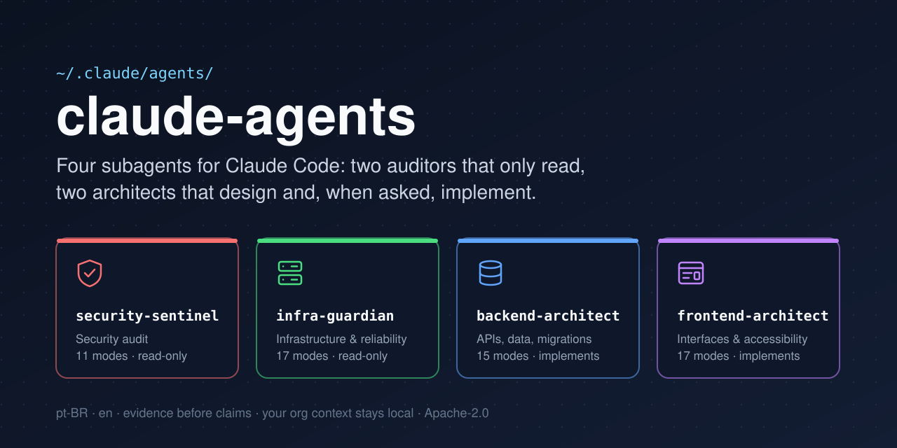

# claude-agents

**English** · [Português](README.pt-BR.md)



A collection of subagents for [Claude Code](https://code.claude.com/docs/en/sub-agents), each with a ready-to-install agent, documentation, evaluations and a way to receive your organization's context without that context entering the repository.

## Agents

| Agent | What it does | Status |
|---|---|---|
| [`security-sentinel`](security-sentinel/) | Read-only, evidence-based security audit: code, APIs, network (via files), infrastructure, supply chain, CI and AI systems (LLM, agents, MCP, RAG). Eleven modes, from `triage` to `release-gate` | Initial (v0.1) |
| [`infra-guardian`](infra-guardian/) | Read-only infrastructure and reliability review (SRE, DevOps, platform, databases, FinOps): VPS, Docker, Kubernetes, IaC, network, CI/CD, observability, backup and DR, capacity, incidents and cost. Seventeen modes, from `discover` to `verify-change`; it never applies changes, it delivers plans with rollback. Comes with a `static` variant without Bash | Initial (v0.1) |
| [`backend-architect`](backend-architect/) | Backend architect and engineer: APIs, domain rules, databases, integrations, migrations and tests. Reads the whole repository before proposing, preserves what works and **implements when asked**. Fifteen modes, from `discover` to `verify` | Initial (v0.1) |
| [`frontend-architect`](frontend-architect/) | Frontend architect and engineer: UX, design system, accessibility (WCAG 2.2 AA), responsiveness, rendering, performance and tests. Follows the existing visual identity and **implements when asked**. Seventeen modes | Initial (v0.1) |

The agents complement each other: the two auditors (Sentinel and Guardian) only read; the two architects design and, if you ask, implement. **How to use and call each one, and how they work together: [`GUIDE.md`](GUIDE.md).**

## How each agent is organized

```text
<agent>/
├── agent/
│   ├── pt-BR/<agent>.md      ← copy ONE language to ~/.claude/agents/
│   └── en/<agent>.md         (some agents also ship variants, e.g. <agent>-static.md)
├── org-context-example/      ← fictitious template of the organizational context
│   ├── pt-BR/SKILL.md
│   └── en/SKILL.md
└── docs/
    ├── pt-BR/
    └── en/
```

## Organizational context stays on your machine

A generic agent makes more mistakes. That is why each agent can preload a local skill, `<agent>-org-context`, with what only your organization knows: systems, where they run, network, accounts, known risks and internal rules.

- The skill lives at `~/.claude/skills/<agent>-org-context/SKILL.md`, **outside this repository**.
- If it does not exist, Claude Code skips the preloading and the agent runs in generic mode.
- This repository's `.gitignore` ignores `*-org-context/` folders as a safeguard, but the main rule is: real context never goes in here.
- Never put a password, token or key in the context. Write where the credential is and what the risk is.

## Quick install

```powershell
# Windows (PowerShell)
Copy-Item .\security-sentinel\agent\en\security-sentinel.md "$env:USERPROFILE\.claude\agents\"
Copy-Item .\infra-guardian\agent\en\infra-guardian.md "$env:USERPROFILE\.claude\agents\"
```

```bash
# Linux and macOS
cp security-sentinel/agent/en/security-sentinel.md infra-guardian/agent/en/infra-guardian.md ~/.claude/agents/
```

To install all four at once, see the [guide](GUIDE.md), section 2. Then, in a new session:

- `Use the security-sentinel agent to run triage on this repository, read-only.`
- `Use the infra-guardian agent to run discover on this repository, read-only.`

Details, recommended permissions and limitations: [`security-sentinel/docs/en/SECURITY_SENTINEL_SETUP.md`](security-sentinel/docs/en/SECURITY_SENTINEL_SETUP.md) and [`infra-guardian/docs/en/INFRA_GUARDIAN_SETUP.md`](infra-guardian/docs/en/INFRA_GUARDIAN_SETUP.md).

## Languages

Every agent and every document exists in Portuguese (`pt-BR`) and English (`en`). The two versions change together.

## License

[Apache-2.0](LICENSE).

## Disclaimer

These agents help with review; they do not replace an authorized pentest, human review, a change process or legal advice. A language model can make mistakes: check the evidence of each finding before acting.
